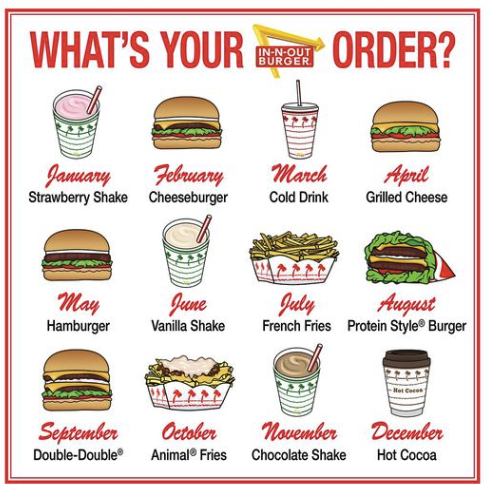
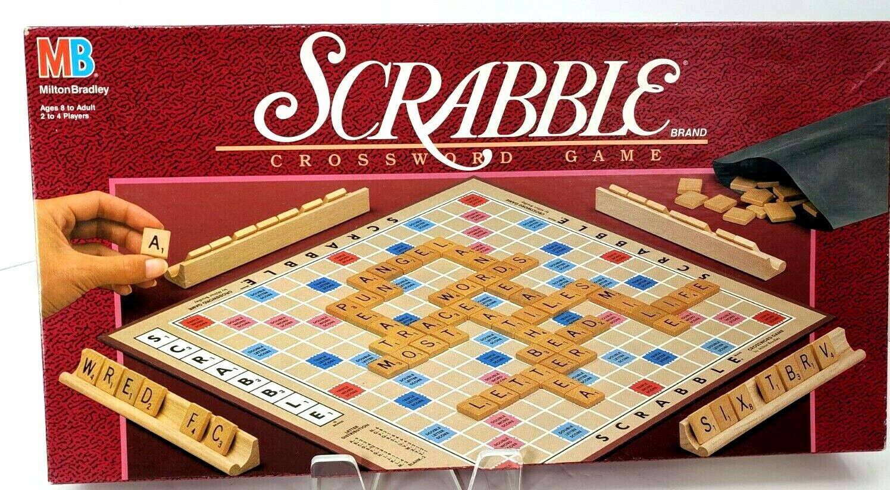

# Project Imitation

## Run the project

Open your own assignment repository in Codespaces (or VS Code). In the terminal:

```sh
npm install
npm start
```

Open port **5500** from the Ports tab in Codespaces, or visit http://localhost:5500 locally.
Keep the terminal running; press Ctrl+C to stop. Save a file to refresh the preview.
If Live Server is missing, run `npm install` again. You can also use Run and Debug → Start Live Server.

- [Getting started with the comparison viewer](./.lesson/part2.md)
- [Codespaces and saving your work](./SandboxOverview.md)
- [Your work plan and visual checks](./TODO.md)

## Project Description

For this project, you must recreate a print layout in HTML and CSS.

- Elements you will need to pay attention to and copy:
- Positioning of Elements
- Color
- Font (family, weight, style)
- Images (positioning, relation to other images, etc. — you don't need the exact images copied)

## Part 0: Pick a Print Design

Pick a print layout worthy of copying. Your layout should contain at least 4 distinct layout elements with a significant degree of complexity. For example, do not simply pick a layout which contains 4 pieces of text all of which are perfectly centered on the page. Upload a copy of your reference image into this repository so I can refer to it when I grade your project. Credit the print design and its source in `index.html` and `citations.html`.

### Example 1: Clearly Complex

Here's an example of a suitably complex design:

This contains a grid of items, each of which has three pieces (image, month, title) and also a title, and finally the logo itself, which is built out of an arrow, a square, and text.

### Example 2: Probably too easy


This ACDC album cover is probably too straightforward. If a student committed to creating the fade effect on "Black Ice" in pure CSS and brought in the borders behind "Black Ice" as unique elements, they could probably convince me this project would be challenging enough, but I'd usually advise they find a different layout to work with.

### Example 3: Surprisingly Challenging!


This scrabble box probably looks too simple at first, but it's actually plenty complex, with the "R" from "Scrabble" overlapping the word "Crossword game" and the placement of "Brand" and "Scrabble" over the underline presenting a challenge. In addition, you've got the way the hands and the scrabble bag overlap the pink-outlined box in the background and the board to contend with. In short, this is a legitimately challenging design!

### How to find your own design?

I recommend you try some google image searches with specific items you find interesting.

For example, I might search Google Images for "magazine cover gravel bike" or "life cereal box." Your goal is to find something that was created for _print_ first, so I recommend things like: book jackets, magazine covers, food labels, game boxes, album covers, or posters. If your design relies on a single image, much of your success will depend on you re-creating that image, so I recommend trying to find designs that make ample use of text, or that use images in ways you can easily imitate.

## Part 1: Pixel-for-Pixel Copy

1. Create a basic mock-up of the layout. Fix the size of your layout so that you can create a pixel-perfect representation of the print layout you copied. Your web layout should be the same dimensions as your print layout.
2. Match color, font, images, and alignments as closely as possible until you've created a pixel-perfect representation.
3. Be thoughtful in using the correct layout for each item: where is the box model adequate? Where is flexbox or grid better? Where do you need absolute positioning to layer items on top of one another?

## Part 2: Responsive Adaptation

1. Create a copy of your pixel-perfect layout and REMOVE the container which fixes the size of the layout.
1. Create a responsive layout which works well in at least 3 sizes: full browser width, tablet size, and phone layout. You may have to change significant parts of the layout to make the new design responsive.
1. Pay attention to what you were able to keep and what you were able to lose from the original design as you moved from print to responsive web design. Specifically, pay attention to the key elements of design we have studied:

- _Contrast_: What elements stand out as different? How did the designer create contrast and draw attention to key elements on the page?
- _Repetition_: What elements repeat? How did the designer create a sense of unity and rhythm to the page?
- _Alignment_: What are the strong alignments on the page? Where are alignments broken?
- _Grouping_: What elements are grouped together? How are those groupings meaningful?

### Honors Credit

For honors credit, you will want to add **animation** to your responsive adaptation to emphasize the fact that this is a web project and not a print one. Pick elements from the original and let them transition into place slowly using transforms.

To do so, you can learn to use keyframes. Here are some tutorials:

- [Keyframes tutorial](https://www.joshwcomeau.com/animation/keyframe-animations/)
- [W3 Schools Overview](https://www.w3schools.com/css/css3_animations.asp)

## Working with AI

This project welcomes substantial AI assistance, including generating HTML/CSS, debugging,
explaining layout, and adapting your fixed design for different screens. You remain the
visual designer and reviewer: an AI response that says “done” does not prove the design matches.

1. Choose your reference and get teacher approval. Describe its layout, hierarchy, and dimensions.
2. Ask AI for a specific piece of the design. Read the code and ask about anything you cannot explain.
3. Run the page and compare the original and imitation using **Side-by-side**. Open the imitation
   in its own tab to check its actual dimensions; the viewer may scale the original to fit.
4. Identify concrete differences yourself: alignment, spacing, proportions, typography, color,
   cropping, and layering. Give AI that feedback and repeat.
5. Open `responsive.html` in its own tab and inspect phone, tablet, and desktop widths
   (for example 375, 768, and 1440 CSS pixels). Check intermediate widths too: no accidental
   horizontal scrolling, clipping, overlaps, or unreadable text. The iframe responds to its own width.
6. Keep screenshots and brief observations in `TODO.md`: what was wrong, what you changed,
   and what you personally verified. Write your design analysis in your own words.

Cite **all AI assistance** in `citations.html`, including ideas, code, writing, and images.
Wrap generated or substantially rewritten HTML/CSS in comments naming the tool and summarizing
what you asked. Each AI Use entry records the tool, date, help received, and what you changed
or checked. Do not claim a visual check until you have actually performed it. Cite the original
print design, substitute images, fonts, and borrowed code under Sources as well.

Use real HTML elements and CSS to reconstruct the design: a screenshot of the original as the
whole imitation does not meet the project goal. Use vanilla HTML/CSS without frameworks or
student-written JavaScript. Flexbox, grid, and positioning are available for this project.
Keep `do_not_modify/` and the comparison viewer intact; in `index.html`, change only the
reference image, its alt text, and source caption. Your design work belongs in `imitation.html` /
`imitation.css` and `responsive.html` / `responsive.css`.

## Teacher: preparing each year's starter

Maintain the reusable source at [thinkle-iacs/imitation-project](https://github.com/thinkle-iacs/imitation-project).
After updating and checking it, create a separate template repository in the current year's
organization (for example `IACS-26-27/imitation-project`), then use that year's repository
as the GitHub Classroom starter. Keep year-specific assignment links in the shared-drive
Project Imitation Links doc. Do not overwrite prior years' repositories.
The [2024 demo](https://github.com/thinkle-iacs/imitation-project-demo) is a historical example,
not the current starter. GitHub Pages uses the existing workflow with repository root as its
artifact; choose GitHub Actions as the Pages source when enabling publishing.
